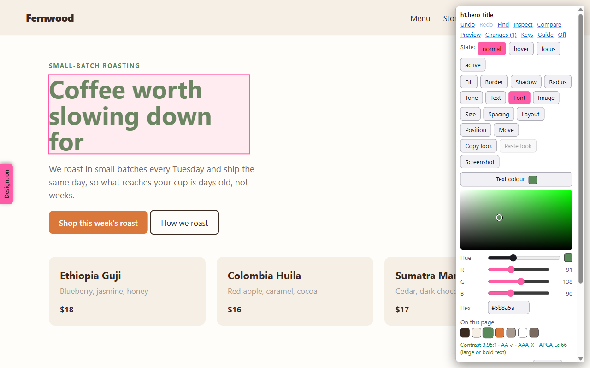

# SiteCleaner

A Chrome extension for designers. Select any element on any page, restyle it, move it, measure it, check its contrast, replace its pictures,
undo all of it, and hand what you changed to a developer (or to Claude) as a compact Markdown change list.

It stands on the ideas of [VisBug](https://github.com/GoogleChromeLabs/ProjectVisBug), the Apache-2.0 editor from Google Chrome Labs
(archived in September 2026), and adds what VisBug never had: **everything you do is recorded**, so it can be undone, kept across reloads and
exported. See [Where it comes from](#where-it-comes-from).

*The name is SiteCleaner (chosen 14 November 2026). Before publishing, check it is free on the Chrome Web Store and read the note on the name in `store/STORE_LISTING.md`.*

## What it does

**Classes.** The Classes link lists the classes the page's style sheets define, most used first: how many elements have each, which file defines it, and its rules
("Rules"); a click selects every element that has the class. It reads a page with thousands of rules in well under a second.

**Select.** Click an element; a label with its name and size appears next to it (and stays at the edge of the window, pointing the way, when it is scrolled out of view). Shift-click adds or removes elements and the tools then change all of them at once. `/` finds everything
that matches a CSS selector (or some words). Walk the page with ↑ parent, ↓ child, Tab siblings; Ctrl+E selects the similar ones.

**Style.** Fill, border, shadow, corner radius, tone (shift the hue, saturation and brightness of a whole selection together); text, font
(colour, size, weight, bold and italic with Ctrl+B and Ctrl+I, line height, letter spacing, alignment); size (type it, or drag the handles), padding and margin, flex and grid layout,
opacity. Copy one element's look and paste it onto others. **Hover and focus:** the State switch above the tools (normal, hover, focus, active) points every tool at
that state: the selected elements are shown in it while you edit, starting from the look the site's own `:hover`, `:focus` or `:active` rules give them, and the
change is written as a rule for the state, undone, saved and exported like any other. Every colour picker lists the colours already on the page, with the names of the
site's CSS variables.

**Check as you go.** Fill and Font show the contrast against what is behind the text: WCAG 2 (AA and AAA) and APCA. The inspector (`I`)
shows whatever is under the pointer: size, type, colours, contrast, role and the name a screen reader would announce, and flags a missing name or alt
text. Hold `M` to measure distances, `G` to see what lines up with the selection, `;` (or the Gridlines button) to draw lines through the selection's edges across the page, `\` to flip back to the original page.

**Edit the page itself.** Delete, duplicate, copy, cut and paste, group and ungroup elements. Double-click text to retype it. Move elements through
the page (arrow keys, or drag a sibling to reorder), or place them anywhere. Drop an image file on a picture, or paste one, to replace it.

**Light or dark.** The dock follows the browser's setting, or is set to either in the Changes panel.

**Undo everything.** One history for all of it: Ctrl+Z and Ctrl+Shift+Z, a slider drag or a run of key presses being a single step. Reset all
puts the page back, in one step you can undo.

**Hand it over.** `Alt+Shift+E` copies the changes as Markdown, written for an AI or a developer who will make them in the source files. The
default **compact** list costs few tokens and says what the source needs to know:
- **Elements are not treated as separate.** Elements that received the same edits are one entry, named by what they share: `.tile ×5` means all five
  elements with that class changed alike (so it is a change to the class's rule), while `2 of 5 .tile` says only two of the five did (so: the rule, or a
  variant?). Shared structure counts too (`.titleline > a ×30`).
- **Where to make the change.** `from: /css/site.css .tile` names the style sheet rule that defines the property now.
- **No before values and no boilerplate**: one line of legend, then the new values. Contrast is mentioned only when it fails WCAG AA.
- On a real page (Hacker News, thirty headline links restyled) the compact list is about 87 tokens against 1,746 for the detailed one.

The Changes panel shows what the list costs, and switches to **detailed**: every element on its own, before and after for every property, contrast, and the
structure changes. [`skills/sitecleaner-apply`](skills/sitecleaner-apply/SKILL.md) is a skill (plain markdown: it works as a Claude Code skill, or pasted into
any AI tool's rules) that teaches an AI how to read a list and apply it to a project: find the right rule, class change or variant, tokens, states, report.
`Alt+Shift+S` saves a screenshot of the selection. Preview opens the page, with your edits, in a window of phone, tablet or laptop size.

Press `?` in the picker for every shortcut.

## Install

    node scripts/build.mjs        # makes dist/
    # Chrome: chrome://extensions > Developer mode > Load unpacked > dist

Then click the toolbar icon, or press **Alt+Shift+P**, on any page.

## Permissions and privacy

`activeTab`, `scripting` and `storage`. The picker runs only on the tab you click it on. Access to **every site is optional** (the options page):
it is what lets your edits come back by themselves after a reload, and lets previews show them. Nothing is collected or sent anywhere; your edits
stay in this browser, in `chrome.storage`, out of reach of the page's own scripts. See `store/PRIVACY.md`.

## How it is put together

The picker is one script built from the files in `src/parts/`, joined in name order (they are slices of one closure and share its state):

| Files | What is in them |
|---|---|
| `010` where it runs | the **host adapter**: everything that depends on the place it runs (storage, mounting, previews, screenshots) |
| `020`–`080` | helpers, colour and contrast, the page's colours, the state, the outlines, selectors |
| `090`–`120` | recording edits, **undo and redo**, **structure operations** (`105`), saved edits, the export |
| `130`–`230` | the colour picker, compare, preview, layout, copy a look, measuring, the inspector, find, tone, guides |
| `240`–`280` | the dock and guide, the Font, Size, Spacing and Radius tools, the changes panel, the picker's mode and keys |
| `300`–`360` | **adapted from VisBug**: editing structure, text in place, Move, Position, images; the screenshot; shortcuts |
| `900` | start-up |

`extension/` is what is not the picker: `host.js` (storage in `chrome.storage`, the UI in a Shadow DOM so the page's CSS cannot touch it,
previews and screenshots through the worker), `background.js` (the toolbar button, previews, the screenshot), `restore.js` (puts saved edits back after
a reload) and the options page. **Two kinds of change** go through the same history: style edits (a record of before and after per element) and
structure operations (an object that knows how to undo and redo itself, replayed from selectors after a reload).

To add a feature: a new file in `src/parts/`, registered through the `keyHooks`, `pageEventHooks`, `refreshHooks` and `offHooks` lists in
`060-state.js`, changing styles through the `apply…` functions and the page through `doOps`, so that it is undone, saved and exported for free.

## Test

    bun install                   # Playwright and axe-core
    bun run test                  # the end-to-end suite (171 checks), then the accessibility audit of the dock

Both run offline and must pass. `bun run test:e2e` and `bun run test:a11y` run one each. The suite builds the extension, loads it into Playwright's Chromium
(branded Chrome no longer loads unpacked extensions from the command line) and drives it on a page that is nothing like a designer's own: a strict content
security policy, generated class names, its own CSS variables. It covers every feature above, including the round trip through a reload and through Reset all.
The audit runs axe-core on every tool and panel in both looks of the dock, and must report no violations.

`bun run smoke` tries the extension on real sites (Wikipedia, Hacker News, MDN, GitHub, gov.uk and others: strict security policies, web components,
single-page apps). It needs the network and live pages that change, so it is **not** part of `test`: run it by hand before a release.
`bun run zip` writes the zip for the Web Store (`releases/`), `bun run share` the one to hand to people (`releases/SiteCleaner-<version>-share.zip`: the extension, plain-language
instructions for installing it in Chrome and using it, the licences and the skill for AIs), `bun run screenshots` regenerates the store screenshots from the real extension, and
`bun run promo` the promo tile.

## Where it comes from

Licensed under **Apache-2.0** (`LICENSE`, `NOTICE`). The files adapted from VisBug say so in a header, and `third_party/visbug/README.md` lists them,
what each was adapted from, and what changed. The idea of each came from VisBug; the code was rewritten to run on this foundation. VisBug has no undo,
no saved edits and no export of what changed, and writes to the page directly; here nothing is written without being recorded. The screenshot is new
(VisBug lists a screenshot tool but ships an alert saying "Coming Soon!").

## Known limits

- **Without the all-sites permission a reload turns the picker off** (the extension cannot act on a page until asked): turn it on again and the
  saved edits come back. With the permission they return by themselves, and the picker comes back on if it was on (for pages of the same site, in that tab).
- **States** are hover, focus and active (not visited, focus-within or focus-visible on its own). The page's own state rules are copied from style sheets the picker can read, so a state
  that a site styles from another origin's sheet starts from the normal look. Text, pictures and moving through the page are the same in every state, so those tools
  work on the normal state. State edits are always written with `!important`, to win over the site's own rules.
- **Replaced pictures** that are large (over about 300 KB) are not kept across a reload, and a page whose security policy forbids `data:` images
  cannot show a replaced local file (the change is still recorded and exported).
- **Cross-origin iframes** are separate documents the picker does not reach; **closed shadow roots** on a page cannot be selected into.
- Structure changes are replayed from selectors after a reload. On a page that builds its content differently each time, they may not find their
  elements; they are then kept, listed under Changes, and exported, until you forget them.
- Chrome only for now (Edge works the same way). Firefox needs its own manifest.
